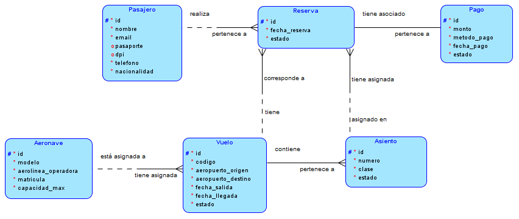
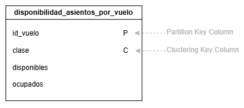
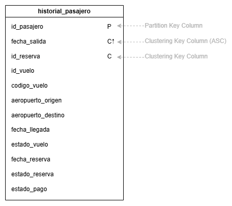
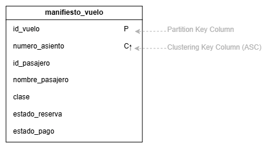
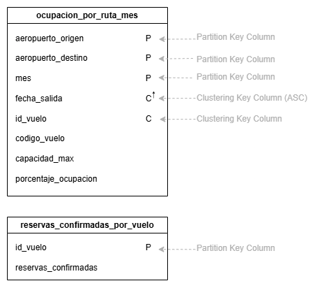
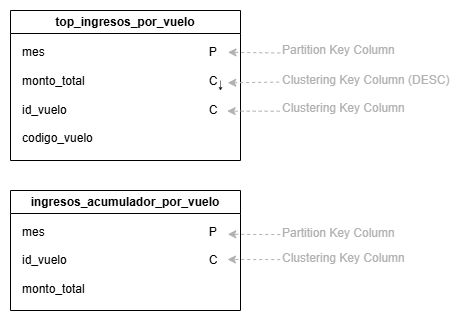
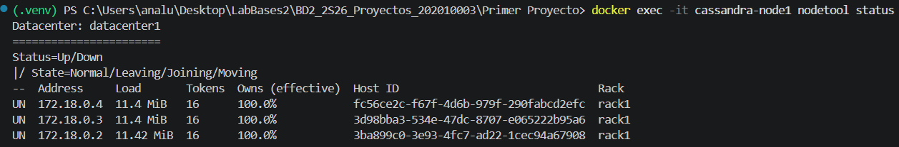
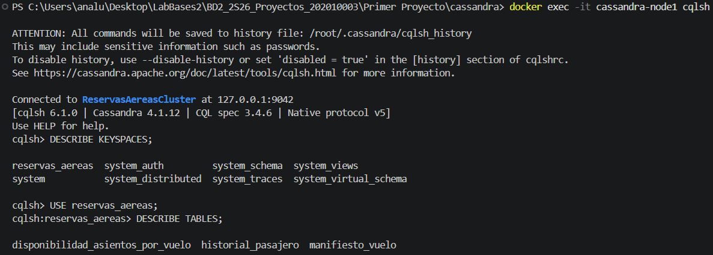
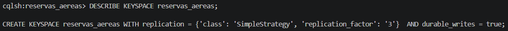

# PROYECTO #1 - Sistema de gestión de reservas y boletos aéreos con Apache Cassandra

| Campo | Dato |
|:-----:|:----:|
| **Curso:** | Sistemas de Bases de Datos 2 |
| **Nombre:** | Ana Lucia Fletes Ordóñez |
| **Carné:** | 202010003 |

## Introducción


## Índice


## Entidades

| Entidad | Descripción | Atributos |
|:-------:|-------------|-----------|
| Pasajero | Persona que puede reservar y comprar boletos. | id, nombre, email, pasaporte, dpi, telefono, nacionalidad |
| Aeronave | Avión utilizado para operar los vuelos. | id, modelo, aerolinea_operadora, matricula, capacidad_max |
| Vuelo | Trayecto programado entre dos aeropuertos. | id, codigo, id_aeronave, aeropuerto_origen, aeropuerto_destino, fecha_salida, fecha_llegada, estado |
| Asiento | Unidad de capacidad de un vuelo específico. | id, id_vuelo, numero, clase, estado |
| Reserva | Registro de la intención de un pasajero de ocupar un asiento en un vuelo. | id, id_pasajero, id_vuelo, id_asiento, fecha_reserva, estado |
| Pago | Transacción asociada a una reserva. | id, id_reserva, monto, metodo_pago, fecha_pago, estado |


## Relaciones

**Vuelo - Aeronave**

Tomando en cuenta los atributos asignados a las entidades, un vuelo debe tener asociada una aeronave, y una aeronave puede operar en múltiples vuelos. Eso nos daría como resultado una relación de uno a muchos.

VUELO ─────(N:1)----- AERONAVE

**Asiento - Vuelo**

Los asientos son descritos como "unidad de capacidad de un <u>vuelo</u> específico", por lo que cada asiento debe pertenecer a un vuelo y un vuelo posee varios asientos, surgiendo una relación de uno a muchos.

ASIENTO ─────(N:1)───── VUELO

**Reserva - Pasajero**

De acuerdo con la primera regla de negocio proporcionada: "Un <u>pasajero</u> puede <u>reservar</u> múltiples vuelos en fechas y rutas distintas". Por lo tanto, un pasajero puede tener muchas reservas, siendo esta una relación de uno a muchos.

RESERVA ─────(N:1)----- PASAJERO

**Reserva - Vuelo**

Según la cuarta regla de negocio: "El número de <u>reservas</u> confirmadas de un <u>vuelo</u>...", lo que nos indica que un vuelo específico puede tener varias reservas y las reservas deben pertenecer a un vuelo. Con ello se obtiene una relación de uno a muchos.

RESERVA ─────(N:1)----- VUELO

**Reserva - Asiento**

Tomando en cuenta la descripción de una reserva: "registro de la intención de un pasajero de ocupar un <u>asiento</u> en un vuelo", se puede decir que toda reserva debe tener asignado un asiento. Por otro lado, un mismo asiento puede estar asociado a distintas reservas a lo largo del tiempo, siempre que no se encuentre asignado simultáneamente a más de un pasajero para el mismo vuelo.

RESERVA ─────(N:1)----- ASIENTO

**Pago - Reserva**

Según la quinta regla de negocio: "Cada <u>reserva</u> debe tener asociado un <u>pago</u> con su estado correspondiente...". Con ello, se identifica una relación de uno a uno.

PAGO ─────(1:1)───── RESERVA


## Reglas de negocio

1. Un pasajero puede reservar múltiples vuelos en fechas y rutas distintas.
2. Un asiento de un vuelo específico solo puede estar asignado a un pasajero a la vez.
3. Las reservas pueden modificarse o cancelarse hasta 24 horas antes de la hora de salida del vuelo.
4. El número de reservas confirmadas de un vuelo no puede superar la capacidad máxima de la aeronave asignada (control de sobreventa).
5. Cada reserva debe tener asociado un pago con su estado correspondiente (pendiente, pagado o reembolsado).
6. Si un vuelo es cancelado, el cambio de estado debe reflejarse en todas las reservas y pagos asociados a ese vuelo.
7. Se deben permitir consultas agregadas de ocupación e ingresos (no solo listados simples), como el porcentaje de ocupación por vuelo y el ranking de vuelos por ingresos generados.


## Restricciones de dominio

Los atributos de estado solo podrán tomar los valores definidos por el negocio:

| Atributo | Valores |
|:--------:|---------|
| Estado del vuelo | `programado`, `retrasado`, `cancelado`, `completado` |
| Clase del asiento | `económica`, `ejecutiva`, `primera clase` |
| Estado del asiento | `disponible`, `ocupado`, `bloqueado` |
| Estado de la reserva | `pendiente`, `confirmada`, `cancelada` |
| Estado del pago | `pendiente`, `pagado`, `reembolsado` |


## Modelo conceptual

### Modelo Entidad-Relación



### Descripción de las relaciones

**Pasajero – Reserva**

* Un PASAJERO puede realizar una o muchas RESERVAS.
* Una RESERVA debe pertenecer a un solo PASAJERO.

**Reserva – Pago**

* Una RESERVA debe tener asociado un solo PAGO.
* Un PAGO debe pertenecer a una sola RESERVA.

**Aeronave – Vuelo**

* Una AERONAVE puede estar asignada a uno o muchos VUELOS.
* Un VUELO debe tener asignada una sola AERONAVE.

**Vuelo – Asiento**

* Un VUELO debe contener uno o muchos ASIENTOS.
* Un ASIENTO debe pertenecer a un solo VUELO.

**Vuelo – Reserva**

* Un VUELO puede tener una o muchas RESERVAS.
* Una RESERVA debe corresponder a un solo VUELO.

**Reserva – Asiento**

* Una RESERVA debe tener asignada un solo ASIENTO.
* Un ASIENTO puede estar asignado en una o muchas RESERVAS.


## Consultas del negocio

| No. | Consulta | Filtros | Clustering / Ordenamiento |
|:---:|----------|---------|---------------------------|
| Q1 | Obtener la cantidad de asientos disponibles y ocupados de un vuelo específico, desglosada por clase | `id_vuelo` | `clase` |
| Q2 | Obtener los vuelos y reservas de un pasajero dentro de un rango de fechas, incluyendo el estado del pago | `id_pasajero`, `fecha_salida` | `fecha_salida ASC` |
| Q3 | Obtener el listado de pasajeros de un vuelo específico, incluyendo la clase del asiento, el estado de la reserva y el estado del pago | `id_vuelo` | `numero_asiento ASC` |
| Q4 | Obtener el porcentaje de ocupación de cada vuelo de una ruta específica dentro de un rango de fechas | `aeropuerto_origen`, `aeropuerto_destino`, `mes`, `fecha_salida` | `fecha_salida ASC` |
| Q5 | Obtener los N vuelos con mayor ingreso dentro de un rango de fechas, ordenados de mayor a menor | `mes` | `monto_total DESC` |


### Tabla 1: Disponibilidad de asientos por clase para un vuelo específico

**Q1 - Obtener la cantidad de asientos disponibles y ocupados de un vuelo específico, desglosada por clase.**

```cql
QUERY:

SELECT *
FROM disponibilidad_asientos_por_vuelo
WHERE id_vuelo = ?;
```

**Decisión de diseño:**

* **`id_vuelo` = Partition Key Column**: Debido a que siempre se consulta la disponibilidad de asientos de un vuelo específico.
* **`clase` = Clustering Key Column**: Permite diferenciar y organizar dentro de la partición de cada vuelo los contadores correspondientes a cada clase de asiento.
* **`disponibles` = Counter**: Gestiona la cantidad de asientos disponibles de la clase.
* **`ocupados` = Counter**: Gestiona la cantidad de asientos ocupados de la clase.
* No se requiere bucketing, ya que la partición corresponde a un vuelo específico y contiene una cantidad reducida de filas (una por cada clase de asiento).
* Los contadores deben actualizarse al realizar o cancelar una reserva, manteniendo sincronizada la disponibilidad y ocupación de los asientos de cada clase.
* La tabla almacena directamente los conteos necesarios para responder a la consulta sin realizar el conteo de filas en tiempo de consulta.




### Tabla 2: Historial cronológico de un pasajero

**Q2 - Obtener los vuelos y reservas de un pasajero dentro de un rango de fechas, ordenados cronológicamente e incluyendo el estado del pago.**

```cql
QUERY:

SELECT *
FROM historial_pasajero
WHERE id_pasajero = ?
AND fecha_salida >= ?
AND fecha_salida <= ?
ORDER BY fecha_salida ASC;
```

**Decisión de diseño:**

* **`id_pasajero` = Partition Key Column**: Debido a que siempre se consulta el historial de un pasajero específico.
* **`fecha_salida` = Clustering Key Column [ASC]**: Permite ordenar cronológicamente los vuelos y reservas dentro de la partición y realizar consultas por un rango de fechas utilizando los operadores >= y <=.
* **`id_reserva` = Clustering Key Column**: Permite diferenciar los registros que puedan tener la misma fecha_salida y para mantener la unicidad de las filas.
* No se requiere bucketing en esta consulta, ya que cada partición corresponde a un pasajero específico y la cantidad de datos puede organizarse utilizando fecha_salida como Clustering Column. De esta forma, es posible consultar rangos de fechas y obtener el historial ordenado cronológicamente sin dividirlo en varias particiones.




### Tabla 3: Manifiesto de pasajeros por vuelo

**Q3 - Obtener el listado de pasajeros de un vuelo específico, ordenado por número de asiento, incluyendo la clase del asiento, el estado de la reserva y el estado del pago.**

```cql
QUERY:

SELECT *
FROM manifiesto_vuelo
WHERE id_vuelo = ?
ORDER BY numero_asiento ASC;
```

**Decisión de diseño:**

* **`id_vuelo` = Partition Key Column**: Debido a que siempre se consulta el manifiesto de un vuelo específico.
* **`numero_asiento` = Clustering Key Column [ASC]**: Permite organizar los registros dentro de la partición según el número de asiento y obtener el manifiesto ordenado de forma ascendente.
* No se requiere bucketing, ya que cada partición corresponde a un vuelo específico y contiene únicamente los registros asociados a los pasajeros y asientos de dicho vuelo.
* La tabla contiene únicamente las reservas en estado confirmada o pendiente, ya que estos representan reservas con un asiento asignado.




### Tabla 4: Porcentaje de ocupación por ruta y rango de fechas

**Q4 - Obtener el porcentaje de ocupación de cada vuelo de una ruta específica dentro de un rango de fechas.**

```cql
QUERY:

SELECT *
FROM ocupacion_por_ruta_mes
WHERE aeropuerto_origen = ?
AND aeropuerto_destino = ?
AND mes = ?
AND fecha_salida >= ?
AND fecha_salida <= ?;
```

**Decisión de diseño:**

* **`aeropuerto_origen` + `aeropuerto_destino` + `mes` = Partition Key Column**: Permite agrupar los vuelos por una ruta específica y dividir la información por períodos mensuales, evitando concentrar todos los vuelos de una misma ruta en una única partición.
* **`mes` = Bucket**: Representa el período mensual utilizado para dividir los datos de una misma ruta en diferentes particiones, evitando que una partición crezca excesivamente.
* **`fecha_salida` = Clustering Key Column [ASC]**: Permite ordenar cronológicamente los vuelos dentro de cada partición y realizar consultas por un rango de fechas utilizando los operadores >= y <=.
* **`id_vuelo` = Clustering Key Column**: Permite diferenciar los vuelos que puedan tener la misma fecha_salida dentro de una misma partición.
* **`reservas_confirmadas` = Counter**: Mantiene la cantidad de reservas confirmadas del vuelo, actualizándose cuando una reserva pasa a estar confirmada o deja de estarlo.

Debido a que Cassandra no permite mezclar columnas counter con columnas de tipos normales dentro de una misma tabla, las reservas_confirmadas se almacena en una tabla auxiliar independiente. De esta forma, ocupacion_por_ruta_mes puede mantener las columnas normales necesarias para consultar la ocupación, mientras que reservas_confirmadas_por_vuelo mantiene el contador actualizado.




### Tabla 5: Top N de vuelos por ingresos generados

**Q5 - Obtener los N vuelos con mayor ingreso (suma de pagos confirmados) dentro de un rango de fechas, ordenados de mayor a menor.**

```cql
QUERY:

SELECT *
FROM top_ingresos_por_vuelo
WHERE mes = ?
LIMIT ?;
```

**Decisión de diseño:**

* **`mes` = Partition Key Column**: Agrupa los vuelos por mes, funcionando también como criterio de bucketing para distribuir los registros entre diferentes particiones.
* **`monto_total` = Clustering Key Column [DESC]**: Permite mantener los vuelos ordenados de mayor a menor ingreso dentro de cada partición. Al estar ordenados de esta forma, los vuelos con mayores ingresos se encuentran al inicio de la partición y LIMIT N permite obtener directamente los primeros N vuelos.
* **`id_vuelo` = Clustering Key Column**: Permite diferenciar vuelos que tengan exactamente el mismo monto_total, evitando que dos vuelos con el mismo ingreso sean considerados como el mismo registro.

Para mantener actualizado el ingreso total de cada vuelo se utiliza una tabla auxiliar llamada ingresos_acumulados_por_vuelo. Esta tabla almacena la suma de los pagos confirmados de cada vuelo y utiliza monto_total como COUNTER, permitiendo incrementar el ingreso acumulado cada vez que se confirma un nuevo pago. De esta forma, la tabla mantiene el valor acumulado sin necesidad de recalcular la suma de todos los pagos cada vez que se realiza una consulta.

La tabla top_ingresos_por_vuelo utiliza el valor acumulado de esta tabla para mantener los vuelos ordenados por monto_total de forma descendente. Se requieren ambas tablas porque una está diseñada para acumular los ingresos, mientras que la otra está diseñada para ordenarlos y obtener directamente el Top N.

```cql
QUERY:

SELECT *
FROM ingresos_acumulados_por_vuelo
WHERE mes = ?
```

**Decisión de diseño:**

* **`id_vuelo` = Partition Key**: Permite identificar de forma única el vuelo dentro de cada partición.
* **`monto_total` = Counter**: Mantiene la suma acumulada de los pagos confirmados de cada vuelo. Cada vez que se confirma un pago, el contador puede incrementarse con el monto correspondiente.




### Resumen del modelo lógico

| Tabla | Consulta que resuelve | Partition Key | Clustering Columns | Primary Key |
|:-----:|:---------------------:|:-------------:|:------------------:|:-----------:|
| disponibilidad_asientos_por_vuelo | Q1 | `id_vuelo` | `clase` | ((id_vuelo), clase) |
| historial_pasajero | Q2 | `id_pasajero` | `fecha_salida ASC, id_reserva` | ((id_pasajero), fecha_salida, id_reserva) |
| manifiesto_vuelo | Q3 | `id_vuelo` | `numero_asiento ASC` | ((id_vuelo), numero_asiento) |
| ocupacion_por_ruta_mes | Q4 | `aeropuerto_origen, aeropuerto_destino, mes` | `fecha_salida ASC, id_vuelo` | ((aeropuerto_origen, aeropuerto_destino, mes), fecha_salida, id_vuelo) |
| capacidad_por_vuelo | Q4 (auxiliar) | `id_vuelo` | — | ((id_vuelo)) |
| top_ingresos_por_vuelo | Q5 | `mes` | `monto_total DESC, id_vuelo` | ((mes), monto_total, id_vuelo) |
| ingresos_acumulados_por_vuelo | Q5 (auxiliar) | `mes` | `id_vuelo` | ((mes), id_vuelo) |

Las tablas capacidad_por_vuelo e ingresos_acumulados_por_vuelo funcionan como tablas auxiliares. Se utilizan porque Cassandra tiene restricciones específicas para las tablas con counter y porque algunas consultas requieren mantener datos agregados y ordenados de una forma que facilite su ejecución.


## Modelo físico (CQL)

### Creación del keyspace

* Se utiliza **SimpleStrategy** debido a que el proyecto se implementará en un entorno local de desarrollo compuesto por un único datacenter. Esta estrategia permite distribuir las réplicas dentro del clúster sin requerir una configuración para múltiples datacenters.
* Se establece un **replication_factor: 3**, lo que significa que cada dato tendrá tres réplicas distribuidas entre los nodos del clúster. Debido a que el clúster está compuesto por tres nodos, se busca mantener una copia replicada de los datos en cada nodo, aumentando la disponibilidad de la información ante la falla de uno de ellos.

```cql
CREATE KEYSPACE IF NOT EXISTS reservas_aereas
WITH replication = {
    'class': 'SimpleStrategy',
    'replication_factor': 3
}
AND durable_writes = true;

USE reservas_aereas;
```


### Creación de las tablas

#### Tabla 1: Disponibilidad de asientos por vuelo

```cql
Query:
SELECT * 
FROM disponibilidad_asientos_por_vuelo 
WHERE id_vuelo = ?;
```

Esta tabla permite consultar la cantidad de asientos disponibles y ocupados para cada clase de un vuelo.

```cql
CREATE TABLE IF NOT EXISTS disponibilidad_asientos_por_vuelo (
    id_vuelo UUID,
    clase TEXT,
    disponibles COUNTER,
    ocupados COUNTER,
    PRIMARY KEY ((id_vuelo), clase)
);
```

#### Tabla 2: Historial cronológico de un pasajero

```cql
Query:
SELECT * 
FROM historial_pasajero 
WHERE id_pasajero = ?
ORDER BY fecha_salida ASC;
```

Esta tabla permite consultar el historial de vuelos y reservas de un pasajero ordenado cronológicamente por la fecha de salida.

```cql
CREATE TABLE IF NOT EXISTS historial_pasajero (
    id_pasajero UUID,
    fecha_salida TIMESTAMP,
    id_reserva UUID,

    id_vuelo UUID,
    codigo_vuelo TEXT,
    aeropuerto_origen TEXT,
    aeropuerto_destino TEXT,
    fecha_llegada TIMESTAMP,
    estado_vuelo TEXT,
    fecha_reserva TIMESTAMP,
    estado_reserva TEXT,
    estado_pago TEXT,

    PRIMARY KEY ((id_pasajero), fecha_salida, id_reserva)
) WITH CLUSTERING ORDER BY (
    fecha_salida ASC
);
```

#### Tabla 3: Manifiesto de pasajeros por vuelo

```cql
Query:
SELECT * 
FROM manifiesto_vuelo
WHERE id_vuelo = ?;
```

Esta tabla permite consultar todos los pasajeros asociados a un vuelo y conocer el asiento que ocupa cada uno.

```cql
CREATE TABLE IF NOT EXISTS manifiesto_vuelo (
    id_vuelo UUID,
    numero_asiento TEXT,

    id_pasajero UUID,
    nombre_pasajero TEXT,
    clase TEXT,
    estado_reserva TEXT,
    estado_pago TEXT,

    PRIMARY KEY ((id_vuelo), numero_asiento)
) WITH CLUSTERING ORDER BY (
    numero_asiento ASC
);
```

#### Tabla 4: Ocupación por ruta y mes

#### Tabla 5: Ingresos y Top N de vuelos


## Configuración del clúster (Docker)

Para ejecutar Cassandra en un entorno distribuido se hizo uso de un Docker Compose, donde se configuró un clúster compuesto por tres nodos Cassandra. Estos pertenecen al mismo datacenter (datacenter1) y utilizan una red interna de Docker que permite la comunicación entre ellos. El clúster se configuró con tres nodos debido a que el replication_factor definido para el keyspace es 3, por lo que, de esta manera, cada partición puede mantenerse replicada entre los tres nodos.

### Puertos utilizados

| Nodo | Puerto interno | Puerto del host |
|:----:|:--------------:|:---------------:|
| cassandra-node1 | 9042 | 9042 |
| cassandra-node2 | 9042 | 9043 |
| cassandra-node3 | 9042 | 9044 |

### Verificación del clúster

Una vez creado el archivo docker-compose.yml, se levantan los tres nodos mediante el comando:

```bash
docker compose up -d
```

Para comprobar que los contenedores están ejecutándose, se ejecuta el comando:

```bash
docker ps
```

Donde deben observarse los tres contenedores:

```
cassandra-node1
cassandra-node2
cassandra-node3
```


### Verificación del estado del clúster

El estado del clúster puede comprobarse desde el primer nodo através del comando:

```bash
docker exec -it cassandra-node1 nodetool status
```

Se espera obtener una salida similar a:



Donde el estado `UN` significa:

* **U - Up:** El nodo está disponible.
* **N - Normal:** El nodo se encuentra funcionando normalmente dentro del clúster.

Por lo tanto, se espera que los tres nodos aparezcan como `UN`.


### Verificación del keyspace

Después de comprobar que el clúster está funcionando, se puede verificar que el keyspace exista con:

```bash
docker exec -it cassandra-node1 cqlsh
```

Dentro de cqlsh ejecutar:

```cql
DESCRIBE KEYSPACES;
```

Debe aparecer: `reservas_aereas`

También se puede seleccionar el keyspace:

```cql
USE reservas_aereas;
```

Y consultar las tablas con:

```cql
DESCRIBE TABLES;
```




### Verificación de la replicación

Debido a que el keyspace fue configurado con `'replication_factor': 3`, las particiones de los datos deben mantenerse replicadas en tres nodos del clúster. La configuración puede verificarse mediante:

```cql
DESCRIBE KEYSPACE reservas_aereas;
```

Se debe observar una configuración similar a:

```
CREATE KEYSPACE reservas_aereas
WITH replication = {
    'class': 'SimpleStrategy',
    'replication_factor': '3'
}
AND durable_writes = true;
```




