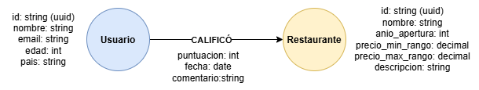
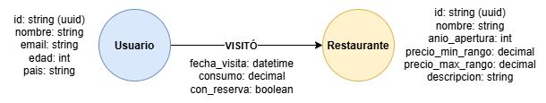
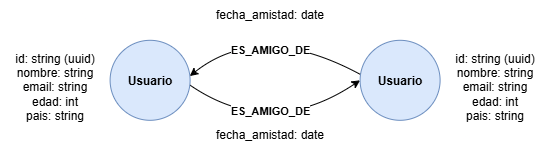
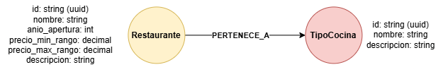
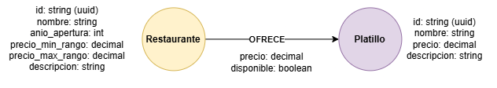
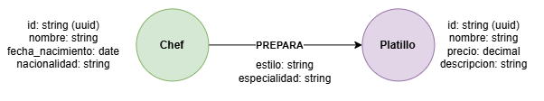
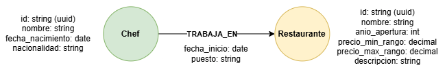
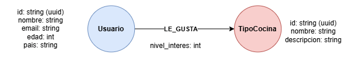
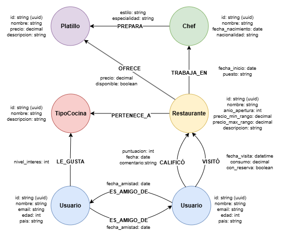

# PROYECTO #2 - Sistema de recomendación de restaurantes con Neo4j

| Campo | Dato |
|:-----:|:----:|
| **Curso:** | Sistemas de Bases de Datos 2 |
| **Nombre:** | Ana Lucia Fletes Ordóñez |
| **Carné:** | 202010003 |

## Modelo NoSQL

### Nodos

**Usuario:** Representa a las personas que utilizan la plataforma.

| Atributo | Descripción | Tipo de dato |
|:--------:|:-----------:|:------------:|
| id | Identificador único del usuario | string (uuid) |
| nombre | Nombre del usuario | string |
| email | Correo electrónico del usuario | string |
| edad | Edad del usuario | int |
| pais | País del usuario | string |

 

**Restaurante:** Comprende el establecimiento gastronómico disponible en la plataforma.

| Atributo | Descripción | Tipo de dato |
|:--------:|:-----------:|:------------:|
| id | Identificador único del restaurante | string (uuid) |
| nombre | Nombre del restaurante | string |
| anio_apertura | Año de apertura del restaurante | int |
| precio_min_rango | Precio mínimo en el rango de precios del restaurante | decimal |
| precio_max_rango | Precio máximo en el rango de precios del restaurante | decimal |
| descripcion | Descripción del restaurante | string |

 

**TipoCocina:** Correspondiente a las categorías gastronómicas.

| Atributo | Descripción | Tipo de dato |
|:--------:|:-----------:|:------------:|
| id | Identificador único del tipo de cocina | string (uuid) |
| nombre | Nombre del tipo de cocina | string |
| descripcion | Descripción del tipo de cocina | string |

 

**Chef:** Son las personas que lideran la preparación culinaria.

| Atributo | Descripción | Tipo de dato |
|:--------:|:-----------:|:------------:|
| id | Identificador único del chef | string (uuid) |
| nombre | Nombre del chef | string |
| fecha_nacimiento | Fecha de nacimiento del chef | date |
| nacionalidad | Nacionalidad del chef | string |

 

**Platillo:** Referente a las preparaciones ofrecidas por los restaurantes.

| Atributo | Descripción | Tipo de dato |
|:--------:|:-----------:|:------------:|
| id | Identificador único del platillo | string (uuid) |
| nombre | Nombre del platillo | string |
| precio | Precio del platillo | decimal |
| descripcion | Descripción del platillo | string |

 

### Relaciones

| Relación | Origen | Destino | Descripción | Propiedades | Notación |
|:--------:|:------:|:-------:|-------------|:-----------:|:--------:|
| CALIFICÓ | Usuario | Restaurante | Un usuario calificó un restaurante | puntuacion [1-5] (int), fecha (date), comentario (string) | Usuario ──CALIFICÓ──> Restaurante |
| VISITÓ | Usuario | Restaurante | Un usuario visitó un restaurante | fecha_visita (datetime), consumo (decimal), con_reserva [true/false] (boolean) | Usuario ──VISITÓ──> Restaurante |
| ES_AMIGO_DE | Usuario | Usuario | Un usuario es amigo de otro usuario (relación de amistad entre usuarios) | fecha_amistad (date) | Usuario <──ES_AMIGO_DE──> Usuario |
| PERTENECE_A | Restaurante | TipoCocina | Un restaurante pertenece a uno o más tipos de cocina | - | Restaurante ──PERTENECE_A──> TipoCocina |
| OFRECE | Restaurante | Platillo | Un restaurante ofrece un platillo | precio (decimal), disponible [true/false] (boolean) | Restaurante ──OFRECE──> Platillo |
| PREPARA | Chef | Platillo | Un chef prepara un platillo | estilo (string), especialidad (string) | Chef ──PREPARA──> Platillo |
| TRABAJA_EN | Chef | Restaurante | Un chef trabaja en un restaurante | fecha_inicio (date), puesto (string) | Chef ──TRABAJA_EN──> Restaurante |
| LE_GUSTA | Usuario | TipoCocina | Un usuario tiene preferencia por un tipo de cocina | nivel_interes [1-5] (int) | Usuario ──LE_GUSTA──> TipoCocina |

**CALIFICÓ**

**VISITÓ**

**ES_AMIGO_DE**

**PERTENECE_A**

**OFRECE**

**PREPARA**

**TRABAJA_EN**

**LE_GUSTA**

### Reglas de negocio

* Un usuario puede calificar y visitar múltiples restaurantes.
* Un restaurante puede pertenecer a varios tipos de cocina y ofrecer múltiples platillos.
* Un chef puede trabajar en varios restaurantes a lo largo del tiempo y preparar múltiples platillos.
* Las calificaciones deben estar en el rango de 1 a 5 estrellas.
* Un restaurante no puede ofrecer el mismo platillo más de una vez.
* El sistema debe poder recomendar restaurantes a un usuario basándose en las calificaciones altas que sus amigos (directos e indirectos, hasta 3 grados de separación) han dado a restaurantes que el usuario aún no ha visitado.

### Diagramas Nodos-Relaciones

**GENERAL**

**CON DATOS**

