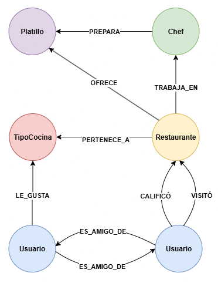
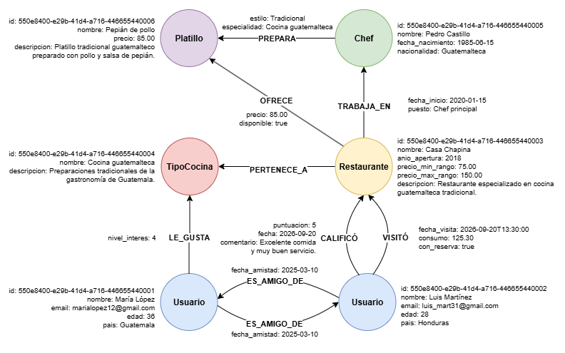
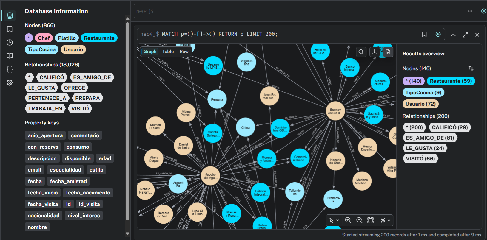
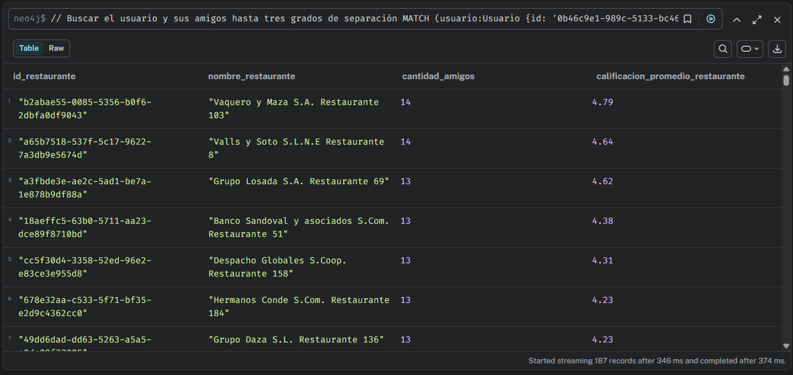
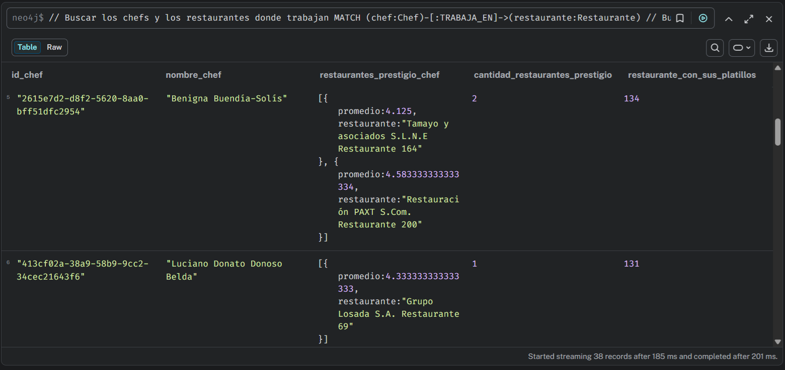
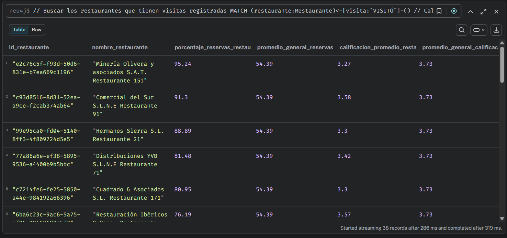
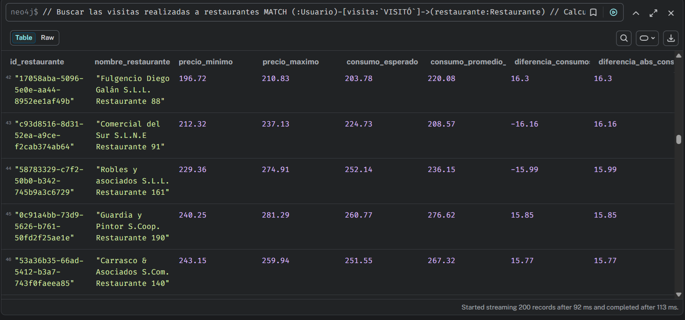
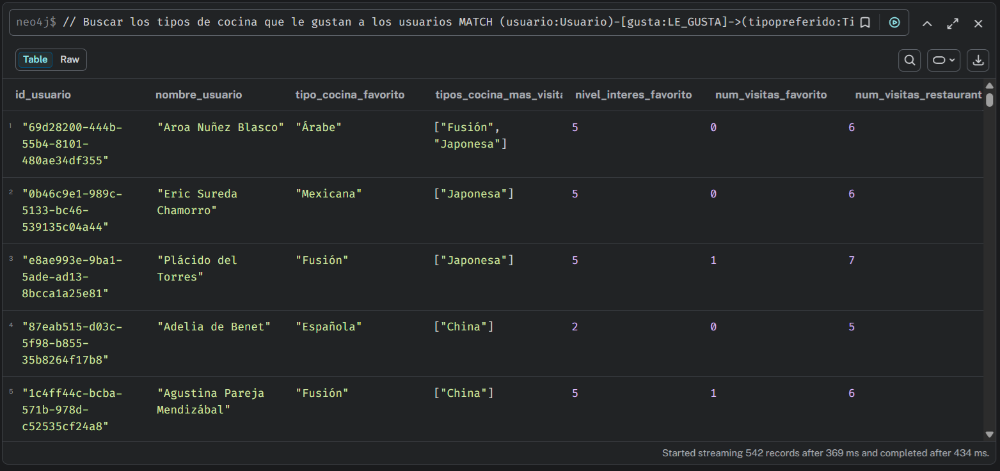

# PROYECTO #2 - Sistema de recomendación de restaurantes con Neo4j

| Campo | Dato |
|:-----:|:----:|
| **Curso:** | Sistemas de Bases de Datos 2 |
| **Nombre:** | Ana Lucia Fletes Ordóñez |
| **Carné:** | 202010003 |


## Modelo NoSQL

### Nodos

**Usuario:** Representa a las personas que utilizan la plataforma.

| Atributo | Descripción | Tipo de dato |
|:--------:|:-----------:|:------------:|
| id | Identificador único del usuario | string (uuid) |
| nombre | Nombre del usuario | string |
| email | Correo electrónico del usuario | string |
| edad | Edad del usuario | int |
| pais | País del usuario | string |

<br/>

**Restaurante:** Comprende el establecimiento gastronómico disponible en la plataforma.

| Atributo | Descripción | Tipo de dato |
|:--------:|:-----------:|:------------:|
| id | Identificador único del restaurante | string (uuid) |
| nombre | Nombre del restaurante | string |
| anio_apertura | Año de apertura del restaurante | int |
| precio_min_rango | Precio mínimo en el rango de precios del restaurante | decimal |
| precio_max_rango | Precio máximo en el rango de precios del restaurante | decimal |
| descripcion | Descripción del restaurante | string |

<br/>

**TipoCocina:** Correspondiente a las categorías gastronómicas.

| Atributo | Descripción | Tipo de dato |
|:--------:|:-----------:|:------------:|
| id | Identificador único del tipo de cocina | string (uuid) |
| nombre | Nombre del tipo de cocina | string |
| descripcion | Descripción del tipo de cocina | string |

<br/>

**Chef:** Son las personas que lideran la preparación culinaria.

| Atributo | Descripción | Tipo de dato |
|:--------:|:-----------:|:------------:|
| id | Identificador único del chef | string (uuid) |
| nombre | Nombre del chef | string |
| fecha_nacimiento | Fecha de nacimiento del chef | date |
| nacionalidad | Nacionalidad del chef | string |

<br/>

**Platillo:** Referente a las preparaciones ofrecidas por los restaurantes.

| Atributo | Descripción | Tipo de dato |
|:--------:|:-----------:|:------------:|
| id | Identificador único del platillo | string (uuid) |
| nombre | Nombre del platillo | string |
| precio | Precio del platillo | decimal |
| descripcion | Descripción del platillo | string |

<br/>

### Relaciones

| Relación | Origen | Destino | Descripción | Propiedades | Notación |
|:--------:|:------:|:-------:|-------------|:-----------:|:--------:|
| CALIFICÓ | Usuario | Restaurante | Un usuario calificó un restaurante | puntuacion [1-5] (int), fecha (date), comentario (string) | Usuario ──CALIFICÓ──> Restaurante |
| VISITÓ | Usuario | Restaurante | Un usuario visitó un restaurante | fecha_visita (datetime), consumo (decimal), con_reserva [true/false] (boolean) | Usuario ──VISITÓ──> Restaurante |
| ES_AMIGO_DE | Usuario | Usuario | Un usuario es amigo de otro usuario (relación de amistad entre usuarios) | fecha_amistad (date) | Usuario <──ES_AMIGO_DE──> Usuario |
| PERTENECE_A | Restaurante | TipoCocina | Un restaurante pertenece a uno o más tipos de cocina | - | Restaurante ──PERTENECE_A──> TipoCocina |
| OFRECE | Restaurante | Platillo | Un restaurante ofrece un platillo | precio (decimal), disponible [true/false] (boolean) | Restaurante ──OFRECE──> Platillo |
| PREPARA | Chef | Platillo | Un chef prepara un platillo | estilo (string), especialidad (string) | Chef ──PREPARA──> Platillo |
| TRABAJA_EN | Chef | Restaurante | Un chef trabaja en un restaurante | fecha_inicio (date), puesto (string) | Chef ──TRABAJA_EN──> Restaurante |
| LE_GUSTA | Usuario | TipoCocina | Un usuario tiene preferencia por un tipo de cocina | nivel_interes [1-5] (int) | Usuario ──LE_GUSTA──> TipoCocina |

**CALIFICÓ**


**VISITÓ**


**ES_AMIGO_DE**


**PERTENECE_A**


**OFRECE**


**PREPARA**


**TRABAJA_EN**


**LE_GUSTA**


### Reglas de negocio

* Un usuario puede calificar y visitar múltiples restaurantes.
* Un restaurante puede pertenecer a varios tipos de cocina y ofrecer múltiples platillos.
* Un chef puede trabajar en varios restaurantes a lo largo del tiempo y preparar múltiples platillos.
* Las calificaciones deben estar en el rango de 1 a 5 estrellas.
* Un restaurante no puede ofrecer el mismo platillo más de una vez.
* El sistema debe poder recomendar restaurantes a un usuario basándose en las calificaciones altas que sus amigos (directos e indirectos, hasta 3 grados de separación) han dado a restaurantes que el usuario aún no ha visitado.

### Diagramas Nodos-Relaciones

**Nodos y relaciones**



**Nodos, relaciones y propiedades**


**Nodos, relaciones y propiedades con datos de ejemplo**




## Generación y carga de datos

El script `generacion_datos.py`, utiliza las librerías Faker y neo4j para generar datos ficticios de usuarios, restaurantes, chefs, platillos y tipos de cocina, así como las relaciones necesarias para el sistema de recomendación. Para ejecutar el script, primero se debe crear y activar un entorno virtual, verificar las versiones de Python y pip, instalar las dependencias necesarias y guardarlas en el archivo `requirements.txt`. Para ello, se deben ejecutar los siguientes comandos en la terminal, desde la carpeta del proyecto:

```bash
# Crear el entorno virtual
py -m venv .venv

# Activar el entorno virtual
.\.venv\Scripts\Activate.ps1

# Verificar la versión de Python y pip
python --version
python -m pip --version

# Instalar las dependencias
python -m pip install Faker neo4j

# Crear el archivo con las dependencias y sus versiones
python -m pip freeze > requirements.txt

# Ejecutar el script
python ./generacion_datos.py
```

Al finalizar la ejecución del script, se generan los archivos .csv que contienen los datos y las relaciones del proyecto. Estos archivos se utilizan posteriormente para realizar la carga en Neo4j, donde se crean los nodos y las relaciones correspondientes. Una vez completado este proceso, es posible verificar los registros generados y visualizar el grafo para comprobar las conexiones entre las distintas entidades del sistema de recomendación.




## Consultas

### Consulta 1: Recomendación de restaurantes basada en calificaciones de amistades

| Campo | Valor |
|:-----:|-------|
| Nombre | Recomendación de restaurantes basada en calificaciones de amistades |
| Descripción | La consulta tiene el fin de recomendar restaurantes a un usuario tomando en cuenta las calificaciones de cuatro o más estrellas otorgadas por sus amigos, tanto directos como indirectos, hasta tres grados de separación. |
| Criterios | <ul><li>Considerar las relaciones de amistad directas e indirectas hasta tres grados de separación respecto al usuario.</li><li>Incluir únicamente las calificaciones iguales o superiores a cuatro estrellas.</li><li>Excluir los restaurantes que el usuario ya haya visitado.</li><li>Agrupar las recomendaciones por restaurante y contar la cantidad de amigos distintos que lo han calificado con cuatro o más estrellas.</li><li>Ordenar los resultados de mayor a menor según la cantidad de amigos coincidentes y, en caso de empate, según la calificación promedio otorgada por estos.</li></ul> |

**Consulta:**

```sql
// Buscar el usuario y sus amigos hasta tres grados de separación
MATCH (usuario:Usuario {id: '0b46c9e1-989c-5133-bc46-539135c04a44'})-[:ES_AMIGO_DE*1..3]->(amigo:Usuario)

// Descartar que los usuarios sean iguales
WHERE usuario <> amigo

// Conservar solo una aparición de cada amigo
WITH DISTINCT usuario, amigo

// Buscar las calificaciones a los restaurantes por parte de los amigos
MATCH (amigo)-[calificacion:`CALIFICÓ`]->(restaurante:Restaurante)

// Considerar calificaciones iguales o superiores a 4 estrellas y descartar restaurantes que el usuario ya visitó
WHERE calificacion.puntuacion >= 4
    AND NOT EXISTS {
        MATCH (usuario)-[:`VISITÓ`]->(restaurante)
    }

// Calcular la cantidad de amigos y el promedio de calificaciones del restaurante
WITH restaurante,
    count(DISTINCT amigo) AS cantidad_amigos,
    avg(calificacion.puntuacion) AS calificacion_promedio_restaurante

// Retornar los datos correspondientes
RETURN restaurante.id AS id_restaurante,
    restaurante.nombre AS nombre_restaurante,
    cantidad_amigos,
    round(calificacion_promedio_restaurante * 100) / 100.0 AS calificacion_promedio_restaurante

// Ordenar de forma descendente de acuerdo a la cantidad de amigos y luego por calificación promedio del restaurante
ORDER BY cantidad_amigos DESC,
    calificacion_promedio_restaurante DESC;
```

**Propósito:** La consulta tiene como propósito recomendar restaurantes a un usuario a partir de las calificaciones positivas otorgadas por las personas que forman parte de su red de amistades. Para ello, se toman en cuenta los amigos directos e indirectos hasta tres grados de separación, para poder identificar establecimientos que podrían resultar de interés para el usuario. Asimismo, se excluyen los restaurantes que ya ha visitado el usuario, priorizando nuevas opciones según las valoraciones de sus amigos.

**Resultados:** La consulta devuelve los restaurantes recomendados para el usuario, mostrando su ID, nombre, cantidad de amigos coincidentes y la calificación promedio otorgada.

Como se puede visualizar en la imagen de la ejecución de la consulta, se pueden observar los restaurantes recomendados al usuario, los cuales tienen una calificación promedio otorgada por sus amigos directos e indirectos mayor o igual a 4 estrellas. Por ejemplo, podemos observar el primer registro del restaurante "Vaquero y Maza S.A. Restaurante 103", el cual han visitado y calificado 14 amigos del usuario, obteniendo con ello una calificación de 4.79 estrellas. Esto podría ayudar al usuario a decidirse a visitar el restaurante y asegurar que tendrá una buena experiencia.



<br/>

### Consulta 2: Identificación de chefs de alto impacto

| Campo | Valor |
|:-----:|-------|
| Nombre | Identificación de chefs de alto impacto |
| Descripción | La consulta tiene el objetivo de identificar a los chefs que trabajan en restaurantes cuya calificación promedio es superior a cuatro estrellas y cuyos platillos son ofrecidos en al menos tres restaurantes diferentes. |
| Criterios | <ul><li>Considerar los restaurantes en los que trabaja cada chef y cuya calificación promedio sea superior a cuatro estrellas.</li><li>Identificar los platillos preparados por cada chef y determinar en cuántos restaurantes distintos se ofrecen.</li><li>Tomar en cuenta únicamente los chefs cuyos platillos se ofrezcan en al menos tres restaurantes diferentes.</li><li>Mostrar los chefs que cumplen ambos criterios, junto con la cantidad de restaurantes con alta calificación en los que trabajan y la cantidad de restaurantes que ofrecen sus platillos.</li></ul> |

**Consulta:**

```sql
// Buscar los chefs y los restaurantes donde trabajan
MATCH (chef:Chef)-[:TRABAJA_EN]->(restaurante:Restaurante)

// Buscar las calificaciones registradas para cada restaurante
MATCH (:Usuario)-[calificacion:`CALIFICÓ`]->(restaurante)

// Calcular la calificación promedio de cada restaurante
WITH chef, 
    restaurante, 
    avg(calificacion.puntuacion) AS calificacion_prom_restaurante

// Conservar solamente los restaurantes con calificación promedio superior a 4
WHERE calificacion_prom_restaurante > 4

// Agrupar los restaurantes con calificaciones superiores a 4 asociados a cada chef
WITH chef,
    collect({
        restaurante: restaurante.nombre,
        promedio: calificacion_prom_restaurante
    }) AS restaurantes_prestigio_chef

// Buscar los platillos que prepara cada chef y los restaurantes que los ofrecen
MATCH (chef)-[:PREPARA]->(platillo:Platillo)<-[:OFRECE]-(r:Restaurante)

// Calcular el número de restaurantes distintos donde se ofrecen los platillos del chef
WITH chef,
    restaurantes_prestigio_chef,
    count(DISTINCT r) AS restaurante_con_sus_platillos

// Conservar los chefs cuyos platillos están en al menos 3 restaurantes
WHERE restaurante_con_sus_platillos >= 3

// Retornar los datos correspondientes
RETURN chef.id AS id_chef,
       chef.nombre AS nombre_chef,
       restaurantes_prestigio_chef,
       size(restaurantes_prestigio_chef) AS cantidad_restaurantes_prestigio,
       restaurante_con_sus_platillos

// Ordenar según la presencia de sus platillos y sus restaurantes bien calificados.
ORDER BY restaurante_con_sus_platillos DESC,
        restaurante_con_sus_platillos DESC;
```

**Propósito:** La consulta tiene como objetivo identificar a los chefs cuyo trabajo está asociado con restaurantes bien calificados (con calificación promedio igual o superio a 4 estrellas) y cuyos platillos tienen presencia en distintos establecimientos (3 o más restaurantes). Para ello, se relaciona a los chefs con los restaurantes donde trabajan y con los platillos que preparan, con el fin de determinar tanto la valoración de los establecimientos como la distribución de sus platillos en otros restaurantes.

**Resultados:** La consulta devuelve los chefs que cumplen con los criterios definidos (trabajar en restaurantes con un promedio de calificación igual o superior a 4 estrellas y que ofrezca sus platillos en al menos 3 restaurantes distintos), mostrando su ID, nombre, restaurantes de prestigio para los que trabaja junto a su calificación promedio, la cantidad de restaurantes de prestigio para los que trabaja y el número de restaurantes distintos que ofrecen sus platillos.

Como se puede visualizar en la imagen de la ejecución de la consulta, la chef "Benigna" trabaja en dos restaurantes de prestigio, siendo uno "Tamayo y asociados S.L.N.E Restaurante 164" con una calificación promedio de 4.125 estrellas, y el otro, "Restauración PAXT S.Com. Restaurante 200" con promedio de 4.583 estrellas. Con ello, podemos notar que estos restaurantes donde trabaja la chef cumplen con el criterio de tener una calificación promedio superior o igual a 4 estrellas. Luego, se nos presenta la cantidad de restaurantes donde hay presencia de sus platillos, que es igual a 134, cumpliendo con el criterio de que sus platillos se ofrezcan en al menos 3 restaurantes distintos. Por tanto, la chef es de alto impacto, ya que trabaja en restaurantes de prestigio y sus platillos son ampliamente ofrecidos en el mercado.



<br/>

### Consulta 3: Identificación de restaurantes infravalorados

| Campo | Valor |
|:-----:|-------|
| Nombre | Identificación de restaurantes infravalorados |
| Descripción | La consulta consiste en identificar los restaurantes que presentan una proporción de visitas con reserva superior al promedio general de la plataforma, pero cuya calificación promedio es inferior al promedio general de calificaciones. |
| Criterios | <ul><li>Calcular la proporción de visitas realizadas con reserva para cada restaurante y el promedio general de dicha proporción en la plataforma.</li><li>Calcular la calificación promedio de cada restaurante y el promedio general de las calificaciones registradas.</li><li>Seleccionar los restaurantes cuya proporción de visitas con reserva sea superior al promedio general y cuya calificación promedio sea inferior al promedio general de la plataforma.</li><li>Ordenar los resultados según la diferencia entre la proporción de visitas con reserva del restaurante y el promedio general, de mayor a menor.</li></ul> |

**Consulta:**

```sql
// Buscar los restaurantes que tienen visitas registradas
MATCH (restaurante:Restaurante)<-[visita:`VISITÓ`]-()

// Calcular el promedio de visitas que se hicieron con reserva de cada restaurante
WITH restaurante,
    avg(CASE
        WHEN visita.con_reserva = true THEN 1.0
        ELSE 0.0
    END) AS tasa_reservas

// Agrupar en una lista cada restaurante con su proporción de reservas y calcular el promedio general de reservas
WITH collect({
    restaurante: restaurante,
    tasa_reservas: tasa_reservas
}) AS datos_reservas,
    avg(tasa_reservas) AS promedio_general_reservas

// Buscar las calificaciones de los restaurantes
MATCH (:Usuario)-[calificacion:`CALIFICÓ`]->(:Restaurante)

// Calcular el promedio general de las calificaciones
WITH datos_reservas,
    promedio_general_reservas,
    avg(calificacion.puntuacion) AS promedio_general_calificaciones

// Separar la lista
UNWIND datos_reservas AS dato

// Recuperar los datos de cada restaurante y conservar los promedios
WITH dato.restaurante AS restaurante,
    dato.tasa_reservas AS tasa_reservas,
    promedio_general_reservas,
    promedio_general_calificaciones

// Buscar las calificaciones del restaurante
MATCH (:Usuario)-[calificacion:`CALIFICÓ`]->(restaurante)

// Calcular la calificación promedio del restaurante
WITH restaurante,
    tasa_reservas,
    promedio_general_reservas,
    promedio_general_calificaciones,
    avg(calificacion.puntuacion) AS calificacion_promedio_restaurante

// Conservar los restaurantes con una tasa de reserva superior al promedio general, pero calificación bajo el promedio
WHERE tasa_reservas > promedio_general_reservas
    AND calificacion_promedio_restaurante < promedio_general_calificaciones

// Retornar los datos correspondientes
RETURN restaurante.id AS id_restaurante,
    restaurante.nombre AS nombre_restaurante,
    round(tasa_reservas * 10000) / 100.0 AS porcentaje_reservas_restaurante,
    round(promedio_general_reservas * 10000) / 100.0 AS promedio_general_reservas,
    round(calificacion_promedio_restaurante * 100) / 100.0 AS calificacion_promedio_restaurante,
    round(promedio_general_calificaciones * 100) / 100.0 AS promedio_general_calificaciones

// Ordenar según la diferencia en la proporción de reservas de forma descendente
ORDER BY tasa_reservas - promedio_general_reservas DESC;
```

**Propósito:** La consulta busca identificar los restaurantes que presentan una proporción/tasa de visitas con reserva superior al promedio general de la plataforma, pero que reciben calificaciones promedio inferiores al promedio general, es decir, establecimientos que registran una proporción de visitas con reserva relativamente alta, aunque sus valoraciones se encuentren por debajo de las obtenidas por los restaurantes en general.

**Resultados:** La consulta devuelve los restaurantes que cumplen con ambas condiciones (tasa de visitas con reserva superior al promedio general y promedio de calificación inferior al general), mostrando su ID, nombre, porcentaje de visitas con reserva, calificación promedio, además de el promedio general de reservas y calificaciones.

Como se puede visualizar en la imagen de la ejecución de la consulta, los restaurantes presentan un porcentaje de visitas con reserva superior al promedio general, como en el primer registro del restaurante "Minería Olivera y asociados S.A.T. Restaurante 151", que tiene un porcentaje de reservas de 95.74, el cual es mayor que el promedio general de la plataforma que es de 54.39. Igualmente, se muestra la calificación promedio del restaurante y el promedio general de las calificaciones, donde el primero es inferior al segundo, como en el primer registro donde la calificación promedio del restaurante es de 3.27, valor que es menor al promedio general de calificaciones de la plataforma que es de 3.73. Con ello, obtenemos el listado de los restaurantes denominados como infravalorados.



<br/>

### Consulta 4: Comparación del rango de precios declarado y el consumo promedio real en restaurantes

| Campo | Valor |
|:-----:|-------|
| Nombre | Comparación del rango de precios declarado y el consumo promedio real en restaurantes |
| Descripción | La consulta busca comparar el rango de precios declarado por cada restaurante con el consumo promedio registrado en sus visitas, con el propósito de identificar aquellos que presentan las mayores diferencias entre el consumo real y el esperado según su categoría de precio. |
| Criterios | <ul><li>Calcular el consumo promedio real registrado en las visitas de cada restaurante.</li><li>Estimar el consumo esperado mediante el punto medio del rango de precios declarado por el restaurante.</li><li>Calcular la diferencia entre el consumo promedio real y el consumo esperado, considerando tanto su magnitud como su dirección.</li><li>Ordenar los resultados de mayor a menor según el valor absoluto de la diferencia, para identificar los restaurantes con las discrepancias más grandes.</li></ul> |

**Consulta:**

```sql
// Buscar las visitas realizadas a restaurantes
MATCH (:Usuario)-[visita:`VISITÓ`]->(restaurante:Restaurante)

// Calcular el consumo promedio real y el consumo esperado
WITH restaurante,
    avg(visita.consumo) AS consumo_promedio_real,
    (restaurante.precio_min_rango + restaurante.precio_max_rango) / 2.0 AS consumo_esperado

// Calcular la diferencia entre consumos y el valor absoluto de esta
WITH restaurante,
    consumo_promedio_real,
    consumo_esperado,
    consumo_promedio_real - consumo_esperado AS diferencia_consumos,
    abs(consumo_promedio_real - consumo_esperado) AS diferencia_abs_consumos

// Retornar los datos correspondientes
RETURN restaurante.id AS id_restaurante,
    restaurante.nombre AS nombre_restaurante,
    restaurante.precio_min_rango AS precio_minimo,
    restaurante.precio_max_rango AS precio_maximo,
    round(consumo_esperado * 100) / 100.0 AS consumo_esperado,
    round(consumo_promedio_real * 100) / 100.0 AS consumo_promedio_real,
    round(diferencia_consumos * 100) / 100.0 AS diferencia_consumos,
    round(diferencia_abs_consumos * 100) / 100.0 AS diferencia_abs_consumos

// Ordenar de forma descendente según la diferencia absoluta entre los consumos
ORDER BY diferencia_abs_consumos DESC;
```

**Propósito:** La consulta tiene como fin analizar la correspondencia entre el rango de precios declarado por los restaurantes y el consumo promedio real registrado durante las visitas de los usuarios. Para realizar esta comparación, se usó el punto medio del rango de precios como estimación del consumo esperado y se calculó la diferencia con respecto al promedio real. De esta manera, se pudieron identificar los restaurantes cuyos consumos registrados presentan mayores variaciones frente al valor estimado.

**Resultados:** La consulta devuelve los restaurantes que cuentan con visitas registradas, mostrando su identificador, nombre, precio mínimo, precio máximo, consumo esperado, consumo promedio real, diferencia entre ambos consumos y la diferencia absoluta (magnitud) de dicho valor.

Como se puede visualizar en la imagen de la ejecución de la consulta, se puede observar en el registro del restaurante "Robles y asociados S.L.L. Restaurante 161" que su precio mínimo es de 229.36 y su precio máximo es de 274.91. Con estos valores se pudo determinar el consumo esperado, siendo este de 252.14, y el consumo promedio real de 236.15, lo cual presenta una discrepancia (ya que, es distinto lo que se espera de lo que se tiene en consumo), siendo esta diferencia de -15.99. Esta diferencia negativa nos indica que el consumo esperado es mayor que el consumo promedio que se tiene realmente, por lo que el restaurante no logra alcanzar su meta u objetivo de consumo. Sin embargo, en otros casos donde la diferencia es positiva, esto significa que el restaurante tiene un consumo promedio real superior al consumo esperado, por lo que cumplen con su objetivo y más. 



<br/>

### Consulta 5: Detección de discrepancias entre el tipo de cocina favorito y el mayormente visitado

| Campo | Valor |
|:-----:|-------|
| Nombre | Detección de discrepancias entre el tipo de cocina favorito y el mayormente visitado |
| Descripción | La consulta tiene el fin de identificar las diferencias entre el tipo de cocina que cada usuario declara como favorito y el tipo de cocina que visita con mayor frecuencia, considerando las visitas registradas a restaurantes y sus respectivos tipos de cocina. |
| Criterios | <ul><li>Identificar el tipo de cocina con mayor nivel de interés declarado por cada usuario.</li><li>Determinar el tipo de cocina correspondiente a los restaurantes que cada usuario ha visitado con mayor frecuencia.</li><li>Comparar la preferencia declarada con el tipo de cocina más visitado e identificar los usuarios cuyos resultados no coincidan.</li><li>Considerar la cantidad de visitas registradas por usuario y tipo de cocina para determinar la frecuencia de visita.</li><li>Mostrar los usuarios que presentan discrepancias, junto con su tipo de cocina favorito, el tipo de cocina más visitado y las frecuencias correspondientes.</li></ul> |

**Consulta:**

```sql
// Buscar los tipos de cocina que le gustan a los usuarios
MATCH (usuario:Usuario)-[gusta:LE_GUSTA]->(tipopreferido:TipoCocina)

// Calcular el mayor nivel de interés y guardar los tipos de cocina preferidos
WITH usuario,
    max(gusta.nivel_interes) AS max_interes,
    collect({tipo: tipopreferido, interes: gusta.nivel_interes}) AS preferencias

// Conservar los tipos de cocina que tienen el nivel de interés máximo
WITH usuario,
    max_interes,
    [preferencia IN preferencias WHERE preferencia.interes = max_interes | preferencia.tipo] AS favoritos

// Buscar las visitas del usuario y los tipos de cocina de los restaurantes
MATCH (usuario)-[visita:VISITÓ]->(:Restaurante)-[:PERTENECE_A]->(tipo:TipoCocina)

// Contar las visitas que realizó a cada tipo de cocina.
WITH usuario,
    max_interes,
    favoritos,
    tipo,
    count(visita) AS num_visitas

// Agrupar los tipos de cocina visitados junto a su cantidad de visitas
WITH usuario, 
    max_interes,
    favoritos,
    collect({tipo: tipo, visitas: num_visitas}) AS restaurante_visitas

// Encontrar la cantidad máxima de visitas entre los tipos de cocina visitados
WITH usuario,
    max_interes,
    favoritos,
    restaurante_visitas,
    reduce(maximo = 0, elemento IN restaurante_visitas |
        CASE
            WHEN elemento.visitas > maximo THEN elemento.visitas
            ELSE maximo
        END
    ) AS max_visitas

// Obtener los tipos de cocina que tienen el número máximo de visitas
WITH usuario, 
    max_interes, 
    favoritos, 
    restaurante_visitas, 
    max_visitas,
    [elemento IN restaurante_visitas WHERE elemento.visitas = max_visitas | elemento.tipo] AS tipos_mas_visitados

// Conservar usuarios que tienen visitas registradas y donde el tipo de cocina más visitado no sea el favorito
WHERE max_visitas > 0
    AND none(tipo IN tipos_mas_visitados WHERE tipo IN favoritos)

// Desagrupar la lista por cada tipo de cocina favorito del usuario
UNWIND favoritos AS favorito

// Calcular las visitas del tipo favorito
WITH usuario,
    max_interes,
    max_visitas,
    tipos_mas_visitados,
    favorito,
    coalesce(head([elemento IN restaurante_visitas WHERE elemento.tipo = favorito | elemento.visitas]), 0) AS num_visitas_favorito

// Retornar los datos correspondientes
RETURN usuario.id AS id_usuario,
       usuario.nombre AS nombre_usuario,
       favorito.nombre AS tipo_cocina_favorito,
       [tipo IN tipos_mas_visitados | tipo.nombre] AS tipos_cocina_mas_visitado,
       max_interes AS nivel_interes_favorito,
       num_visitas_favorito,
       max_visitas AS num_visitas_restaurante_mas_visitado

// Ordenar descendentemente, priorizando las mayores diferencias y luego ordenar por nombre de usuario
ORDER BY num_visitas_restaurante_mas_visitado - num_visitas_favorito DESC,
    nombre_usuario ASC;
```

**Propósito:** La consulta busca a los usuarios cuyo tipo de cocina favorito, determinado por el mayor nivel de interés, no coincide con el tipo de cocina que visitan con mayor frecuencia. Para ello, se comparan las preferencias registradas por el usuario a través de la relación `LE_GUSTA` con las visitas a restaurantes registradas mediante la relación `VISITÓ`.

**Resultados:** La consulta devuelve los registros de los usuarios que presentan discrepancia entre sus preferencias en tipos de cocina y sus hábitos de visita. Para cada usuario se muestra su ID, nombre, tipo de cocina favorito, tipos de cocina más visitados, nivel de interés de su tipo de cocina favorito y la cantidad de visitas correspondientes al tipo de cocina favorito y a los más visitados.

Como se puede visualizar en la imagen de la ejecución de la consulta, se puede visualizar en el primer registro que el usuario de nombre "Aroa" tiene como tipo de cocina preferido el "Árabe", con un nivel de interés en este de 5 (alto), y un número de visitas de 0; sin embargo, se puede notar que los tipos de cocina más visitados por este usuario son los de "Fusión" y "Japonesa", contando ambos con 6 visitas realizadas a cada uno. Con ello, podemos identificar que existe una discrepancia o diferencia entre su preferencia y los que más visita.




